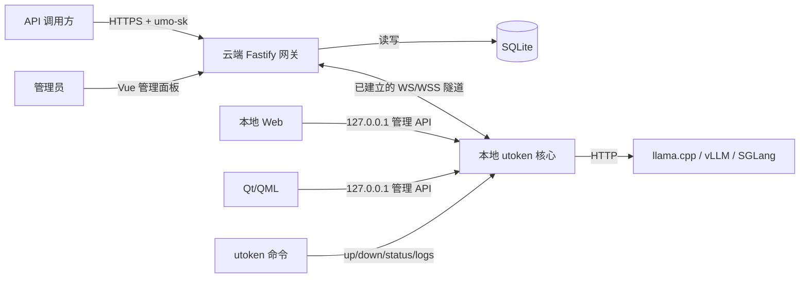
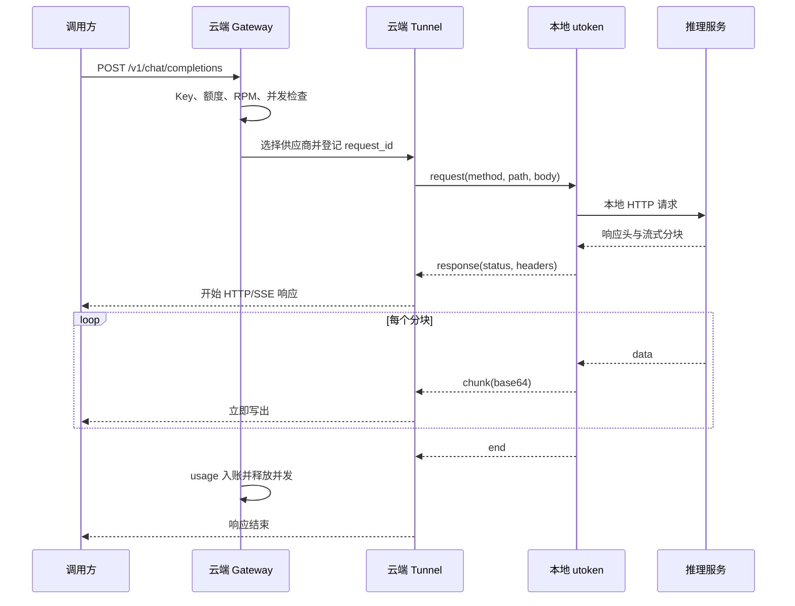

# 架构设计

## 设计目标

Umeko Token Relay 解决的是“没有公网 IP 的自托管模型，如何安全地对外提供可运营 API”。系统不实现推理，而是把**反向连接、协议适配、访问控制、计费和审计**组合成一条链路。

关键约束：

- 云端不能依赖家庭网络的入站连接；
- 本地推理实现保持独立，可自由选择 llama.cpp、vLLM 或 SGLang；
- 流式响应不能在云端等待完整生成后再返回；
- API Key、供应商凭据和管理员会话是不同安全边界；
- CLI 是唯一本地核心，Web/QML 只是控制端。

## 组件视图

## 云端组件

### HTTP 与静态界面

`server/index.js` 注册健康检查、公开 API、管理 API、WebSocket 入口和 Vue 静态构建产物。管理面板与公开 API 共用端口，生产环境通常由 Nginx/Caddy 终止 TLS。

### Gateway

`server/gateway.js` 负责：

1. 从 `Authorization: Bearer` 取得 Key 并查询 SHA-256 哈希；
2. 检查启用状态、过期时间、Token/费用额度和 RPM；
3. 根据模型筛选在线、健康的供应商；
4. 执行 Key 与供应商并发准入；
5. 将请求交给 Tunnel；
6. 观察普通/SSE 响应，提取 usage；
7. 响应结束后原子写入日志并更新 Key 累计值。

### Tunnel

`server/tunnel.js` 保存供应商 socket、待处理请求和心跳状态。每个请求使用 UUID 关联响应头、分块和结束事件。

- 本地连接替换：同一供应商建立新连接时关闭旧连接；
- 心跳：15 秒 ping/pong，失联后终止；
- 健康：本地探测结果写入供应商状态；
- 超时：由系统设置控制，默认 300 秒；
- 取消：客户端断开后向本地发送 `cancel`；
- 流式：每个分块独立 Base64 编码，收到后立即写入响应流。

### 管理与持久化

`server/admin.js` 提供 Cookie 会话保护的管理接口。`server/db.js` 使用 Node.js 内置 `node:sqlite`，启用 WAL、外键和 busy timeout。

## 本地组件

### AgentController

`local-app/src/AgentController.cpp` 是本地核心，负责配置、自动重连、健康探测、请求生命周期和日志。

### WebSocketTransport

`local-app/src/WebSocketTransport.cpp` 在 Qt Network 上实现 RFC 6455 客户端握手和帧处理：

- HTTP Upgrade 与 `Sec-WebSocket-Accept` 校验；
- 客户端掩码帧；
- 16/64 位扩展长度；
- 文本、 continuation、ping/pong 和 close；
- 24 MiB 消息上限；
- WS 与 WSS。

### LocalWebServer

只绑定 `QHostAddress::LocalHost`，提供静态 Web 控制台和 JSON 管理 API。它同时服务 CLI 状态命令和 QML 远程控制器，并校验 Host 头，拒绝非回环主机名。

### RemoteAgentController

QML 使用该类轮询 CLI 服务，而不是创建另一个 `AgentController`。因此 GUI 的启动/停止、配置和日志与 Web/CLI 完全一致。

## 请求时序

## 数据模型

| 表 | 核心内容 |
| --- | --- |
| `admin_users` | 管理员用户名、scrypt 哈希与盐 |
| `users` | 注册用户邮箱、五小时/七天额度、重置起算点和注册 IP |
| `email_challenges` | 验证码 scrypt 哈希、过期时间、尝试次数和发送 IP |
| `providers` | 名称、凭据哈希、最大并发、健康与心跳 |
| `models` | 供应商、对外模型名、输入/输出价格、启用状态 |
| `api_keys` | Key 哈希、额度、限流、累计用量、过期时间 |
| `usage_logs` | 请求 ID、Key、供应商、Token、费用、状态、延迟和错误 |
| `settings` | 服务名称与请求超时 |

金额以整数 micros 保存，避免直接累计浮点美元。供应商和模型删除使用外键规则；请求日志保留模型名称和可空 Key/供应商引用。

## 一致性与扩展边界

当前是**单进程、单 SQLite 数据库**架构。适合个人或小团队中转，但以下状态尚未外置：

- 管理员会话；
- RPM 滑动窗口；
- Key 活动并发；
- 供应商 WebSocket 与待处理请求。

因此不能简单启动多个云端进程实现水平扩展。多实例演进需要共享限流/并发存储、集中会话和可路由的隧道连接层。

## 故障语义

- 无在线模型：公开 API 返回 `503`；
- 本地转发失败或隧道中断：响应前失败返回错误，流中断则终止响应并记录失败；
- 额度或并发超限：`429`；
- 无效/停发/过期 Key：`401`；
- 本地推理异常：健康状态阻止后续调度；
- 云端重启：所有本地连接器按指数退避自动重连，最大 30 秒。
